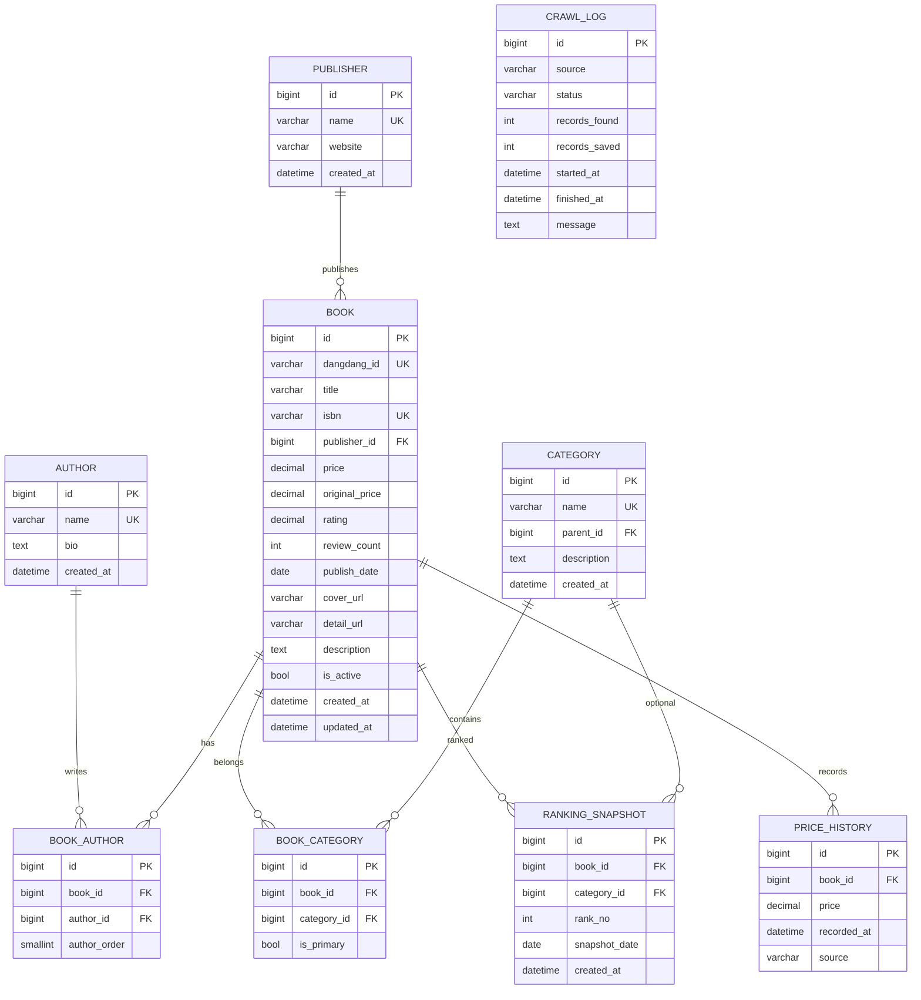

# 数据库设计说明

> 表结构以 `books/models.py` 为唯一来源。本文档用于答辩时说明 E-R 关系、表含义和索引设计。

## 1. E-R 图



关系说明：

- 一家出版社可以出版多本书；一本书最多对应一家出版社。
- 一本书可以有多个作者，一个作者可以写多本书，因此使用 `book_author` 关联表，并记录作者顺序。
- 一本书可以属于多个分类，一个分类可以包含多本书，因此使用 `book_category` 关联表，并用 `is_primary` 标记主分类。
- 一本书在多个日期、多个榜单上会有多条排名记录，因此使用 `ranking_snapshot` 保存榜单快照。`category_id` 为空表示总榜。
- 一本书会随采集时间产生多条价格记录，因此使用 `price_history` 保存价格变化。
- `crawl_log` 独立记录每次爬取/导入的结果，便于说明数据来源和失败情况。

## 2. 表结构说明

| 表名 | 作用 | 关键字段 |
|---|---|---|
| `publisher` | 出版社 | `name` 唯一 |
| `author` | 作者 | `name` 唯一 |
| `book` | 图书主表 | `isbn` 唯一，`price`、`rating` 用于列表排序 |
| `book_author` | 图书-作者多对多 | 联合唯一 `(book_id, author_id)` |
| `category` | 分类，支持父子分类 | `parent_id` 自关联 |
| `book_category` | 图书-分类多对多 | 联合唯一 `(book_id, category_id)` |
| `ranking_snapshot` | 榜单快照 | `(book_id, category_id, snapshot_date)` 联合唯一 |
| `price_history` | 价格历史 | 按 `book_id + recorded_at` 查询 |
| `crawl_log` | 采集日志 | `status` 记录成功/部分成功/失败 |

## 3. 主要 SQL 示例

### 3.1 最新总榜 Top 10

```sql
SELECT b.id, b.title, b.price, b.rating, rs.rank_no
FROM ranking_snapshot rs
JOIN book b ON b.id = rs.book_id
WHERE rs.snapshot_date = (
        SELECT MAX(snapshot_date) FROM ranking_snapshot
      )
  AND rs.category_id IS NULL
ORDER BY rs.rank_no
LIMIT 10;
```

页面位置：仪表盘“最新总榜 Top 10”。

### 3.2 各出版社图书数量

```sql
SELECT p.name, COUNT(*) AS book_count
FROM book b
JOIN publisher p ON p.id = b.publisher_id
GROUP BY p.id, p.name
ORDER BY book_count DESC, p.name ASC;
```

页面位置：仪表盘“各出版社图书数量”。

### 3.3 某本书的价格历史

```sql
SELECT price, recorded_at, source
FROM price_history
WHERE book_id = 1
ORDER BY recorded_at;
```

页面位置：图书详情“价格历史”。

## 4. 索引设计

| 索引 | 字段 | 用途 |
|---|---|---|
| `idx_book_title` | `title` | 书名搜索 |
| `idx_book_publisher` | `publisher_id` | 按出版社关联/筛选 |
| `idx_book_price` | `price` | 价格排序 |
| `idx_book_rating` | `rating` | 评分排序、榜单计算 |
| `idx_book_publish_date` | `publish_date` | 按出版日期排序 |
| `idx_ranking_date_rank` | `snapshot_date, rank_no` | 查询某天榜单 |
| `idx_ranking_book_date` | `book_id, snapshot_date` | 查询某本书的榜单历史 |
| `idx_price_book_time` | `book_id, recorded_at` | 查询某本书的价格历史 |

## 5. 索引优化实验（答辩用）

目标：对比“有索引/无索引”下按评分排序的执行计划。

### 5.1 实验前

```sql
EXPLAIN ANALYZE
SELECT id, title, price, rating
FROM book
ORDER BY rating DESC
LIMIT 20;
```

记录输出中的 `type`、`rows`、`actual time`。如果出现 `filesort`，说明排序需要额外处理。

### 5.2 删除索引

```sql
ALTER TABLE book DROP INDEX idx_book_rating;
```

### 5.3 再执行同一查询

重复 5.1 的 `EXPLAIN ANALYZE`，记录结果。

### 5.4 恢复索引

```sql
CREATE INDEX idx_book_rating ON book (rating);
```

再次执行查询，对比前后执行计划，把结果写进项目报告。若数据量只有 120 条，差异可能不明显，可以说明“当前数据规模较小，索引收益需要更大数据量才能体现”，这也是合理的实验结论。

## 6. 导出表结构

需要提交 `schema.sql` 时：

```bash
mysqldump -u root -p --no-data dangdang_books > docs/schema.sql
```

不要把数据库密码写进 SQL 文件或提交到 GitHub。
